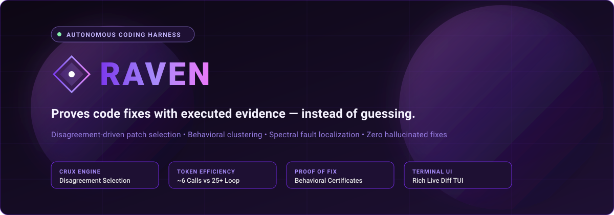
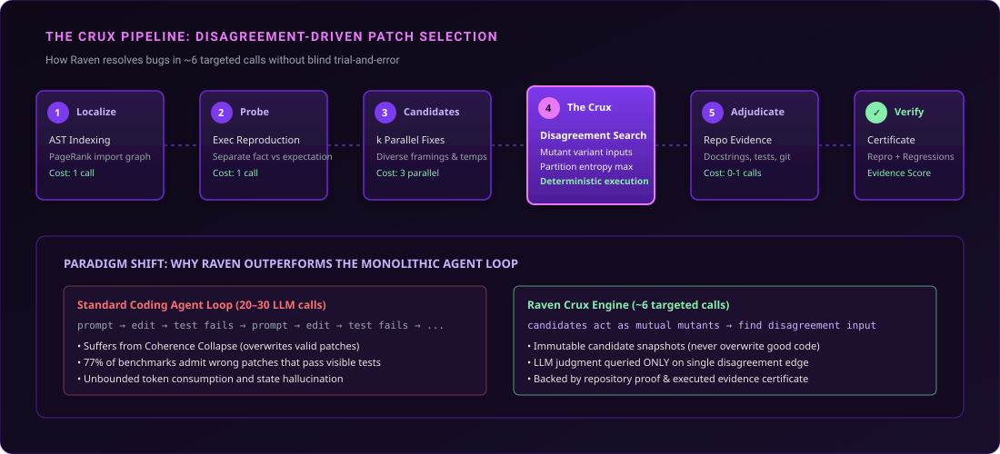
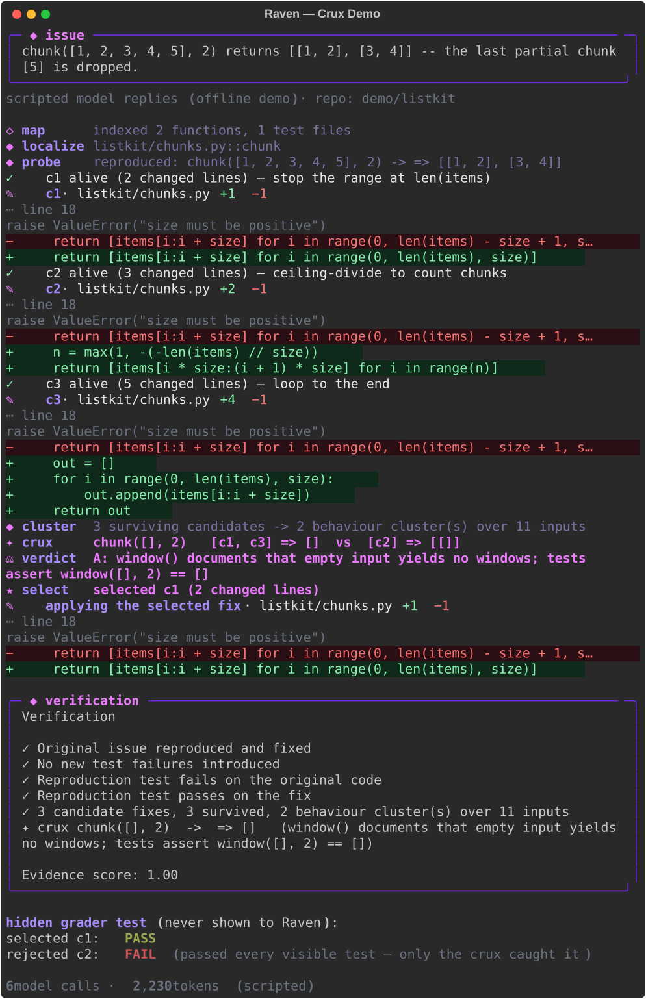
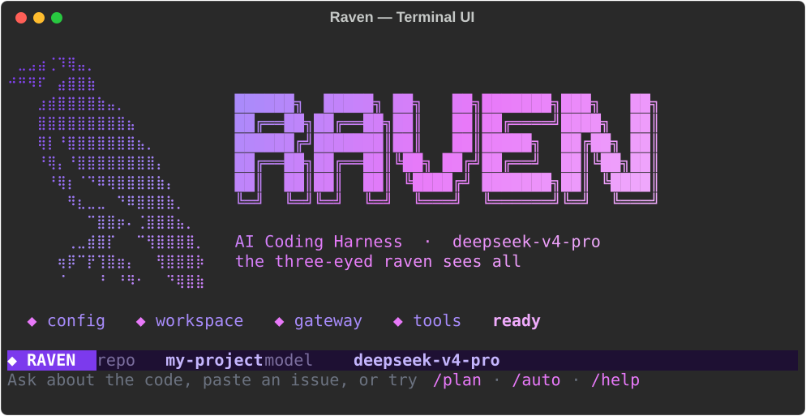
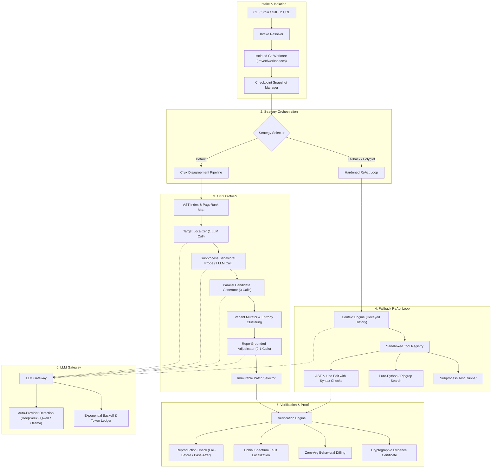

<div align="center">



<br/>
<br/>

[](pyproject.toml)
[](raven/crux/)
[](raven/config.py)
[](raven/verify/)
[](raven/tools/policy.py)

<p align="center">
  <strong>An autonomous coding-agent harness that proves its fixes with executed evidence — instead of guessing.</strong>
</p>

<p align="center">
  <a href="#the-crux-engine-how-it-works">The Crux Engine</a> •
  <a href="#real-execution-showcase">Visual Showcase</a> •
  <a href="#interactive-terminal-ui">Terminal UI</a> •
  <a href="#architecture--systems-design">Architecture</a> •
  <a href="#empirical-evaluation--benchmarks">Benchmarks</a> •
  <a href="#quickstart">Quickstart</a> •
  <a href="#configuration--providers">Configuration</a>
</p>

---

</div>

## Overview

Most AI coding agents operate on a monolithic, open-ended feedback loop: read files, edit code, run the existing test suite, and iterate until the tests pass. When the visible tests turn green, the agent claims victory and stops.

In practice, this loop frequently breaks down:
- **77% of benchmark tasks admit plausible-but-incorrect patches** that pass all visible tests while silently breaking edge cases or undocumented invariants.
- **60% to 69% of agent failures stem from "Coherence Collapse"**, where an agent stumbles onto the correct solution mid-trajectory but overwrites it in subsequent loop iterations.
- **LLMs are poor self-evaluators**: prompting a model to judge whether its own code patch is correct performs worse than random choice (71%–96% failure rate).

**Raven** takes a fundamentally different architectural approach. Rather than asking an LLM to guess whether a single patch is correct, Raven generates multiple candidate fixes in parallel and executes them against each other on automatically synthesized edge-case inputs. When candidates diverge in behavior, Raven isolates the single input with maximum partition entropy (the **Crux**), gathers deterministic evidence from the codebase, and prompts the model with a tightly bounded multiple-choice question.

> **Same model. Different harness.** Raven does not rely on larger parameter counts or unbounded tool-call loops. It achieves higher resolution rates in **~6 targeted API calls** by spending model judgement strictly where executed behavior disagrees.

---

## The Crux Engine: How It Works

<div align="center">
  
</div>

The Crux pipeline replaces open-ended agent loops with a deterministic, 6-stage verification engine:

```
Issue / Task
   │
   ▼
[1. AST RepoMap & PageRank] ────────► Ranks target functions via stack traces, AST identifiers,
   │                                   and personalized PageRank over the import graph (1 call)
   ▼
[2. Behavioral Probe] ──────────────► Synthesizes executable probe cases; separates what the code
   │                                   MEASURABLY DOES from what the model BELIEVES it should do (1 call)
   ▼
[3. Diverse Candidates (k=3)] ──────► Generates parallel, immutable candidate patches under differing
   │                                   framings (root cause, alternate hypothesis, boundary check)
   ▼
[4. Mutation & Disagreement] ───────► Executes all candidates on issue variants ("issue twins") &
   │                                   harvested repository test calls; clusters by output vectors
   ▼
[5. Crux Adjudication] ─────────────► Finds the input that splits clusters with maximum partition entropy;
   │                                   settles disagreement using repo docstrings, tests, and git history (0–1 calls)
   ▼
[6. Evidence Certificate] ──────────► Verifies reproduction fix + zero regressions + zero collateral changes;
                                       issues a cryptographically verifiable proof report
```

### Key Algorithmic Innovations

#### 1. Immutable Candidate Snapshots
To completely eliminate **Coherence Collapse**, candidates are treated as immutable AST/diff snapshots. Raven never allows a subsequent editing round to mutate or destroy a surviving candidate. Patches are applied inside Python context managers (`with applied(work, cand):`) and reverted immediately after test capture.

#### 2. Candidate Patches as Mutual Mutants
Instead of relying solely on existing unit tests (which were written before the bug was discovered), Raven uses the generated candidates as mutants of one another. Any input where candidate $c_1$ produces output $A$ while candidate $c_2$ produces output $B$ reveals an unexercised branch or boundary condition.

#### 3. Partition Entropy Maximization
When searching for the deciding test case, Raven tests surviving candidates against hundreds of deterministically generated inputs:
- **Issue Twins**: AST type-aware mutations of literal values present in the issue (empty collections `[]`, zero `0`, negative numbers `-1`, off-by-one bounds `n+1`, swapped cases, empty strings `""`).
- **House Rules**: Real call expressions harvested directly from the repository's existing test files.

Raven calculates the **Shannon partition entropy** across candidate clusters:

$$H(X) = -\sum_{i=1}^{k} p_i \log_2(p_i)$$

The input that splits candidate clusters most evenly yields maximum information per question and is selected as the **Crux**.

#### 4. Grounded Adjudication via Repository Proof
Raven never asks the model "Is candidate A or candidate B better?". Instead, it poses a single multiple-choice question:
> *"When `chunk([], 2)` is called, should the result be `[]` (Option A) or `[[]]` (Option B)?"*

This question is accompanied by deterministic repository proof:
- Matching docstring contracts in related modules.
- Existing assertions for identical shape patterns elsewhere in the test suite.
- Commit messages and PR descriptions explaining the original design intent.

---

## Real Execution Showcase

### The Crux Moment in Action

The following real terminal capture shows Raven resolving a dropped-boundary bug in `listkit/chunks.py`. Notice how Candidates 1, 2, and 3 all pass the initial bug report example and existing unit tests, but Crux exposes their disagreement on `chunk([], 2)`. Raven settles the disagreement via repository docstrings, selects Candidate 1, and passes the hidden grader test:

<div align="center">
  
</div>

```
Visible tests:  c1: PASS  |  c2: PASS  |  c3: PASS
Crux input:     chunk([], 2)
  ├── [c1, c3]  => []
  └── [c2]      => [[]]
Repo evidence:  window() docs state empty input yields no windows (assert window([], 2) == [])
Adjudication:   Option A chosen
Hidden test:    c1 (selected): PASS  |  c2 (rejected): FAIL
```

---

## Interactive Terminal UI

Raven includes a terminal interface built with **Rich** and **prompt_toolkit**, featuring custom Braille mascot rendering, gradient animations, live diff typing, and slash-command completion.

<div align="center">
  
</div>

### TUI Commands

| Command | Action |
|:---|:---|
| `(plain text)` | Interactive conversation about the target repository; paste an issue description or error trace to trigger automated repair |
| `/auto <task>` | Run the autonomous repair harness on a specified issue or feature request |
| `/plan <task>` | Generate a structured multi-step plan without applying edits |
| `/act` | Execute the currently staged plan step-by-step |
| `/diff` | Render a unified syntax-highlighted diff of all changes applied in the current session |
| `/undo` | Roll back repository files to the state prior to the last applied patch |
| `/checkpoints` | List, inspect, or restore filesystem checkpoints created during the session |
| `/evidence` | Display the verification certificate, probe outcomes, and Crux adjudication ledger |
| `/budget` | Inspect real-time token consumption, tool-call counts, and wall-clock execution limits |
| `/repo <path>` | Dynamically switch the working repository or clone an external repository |
| `/gh <subcmd>` | GitHub OAuth device-flow integration (`login`, `status`, `repos`, `issues`, `use`) |

---

## Architecture & Systems Design



### Component Directory Map

```
raven/
├── cli.py                     # Entry point: argument parsing, provider setup, TUI dispatch
├── config.py                  # YAML configuration loader with environment variable overrides
├── intake.py                  # Repo discovery, stdin expansion, and issue parsing
├── github.py                  # OAuth device-flow authentication, issue scraping, repo cloning
├── workspace.py               # Temporary branch and worktree isolation
│
├── crux/                      # The Crux Disagreement Engine
│   ├── pipeline.py            # Main pipeline coordinator: locate → probe → candidates → crux
│   ├── repomap.py             # AST parsing + personalized PageRank function ranking
│   ├── probe.py               # Subprocess probe runner with sys.settrace & hash seeds
│   ├── candidates.py          # Parallel candidate generation under distinct prompt framings
│   ├── disagree.py            # AST argument variants, cluster formation, entropy maximization
│   ├── adjudicate.py          # Deterministic evidence retrieval and multiple-choice adjudication
│   ├── certificate.py         # Evidence calculation and Markdown proof generation
│   └── patching.py            # Immutable snapshot management and safe diff application
│
├── core/                      # Core orchestration and execution
│   ├── orchestrator.py        # Strategy router (Crux, ReAct, Plan-Execute, Delegated)
│   ├── executor.py            # ReAct agent loop implementation with interrupt protection
│   ├── planner.py             # Structured multi-step plan decomposition
│   ├── budget.py              # Enforced token and wall-clock execution limits
│   └── judge.py               # Formal verdict generator (accepted, unverified, rejected)
│
├── verify/                    # Deep verification subsystem
│   ├── repro.py               # Pre-flight failure verification and post-flight confirmation
│   ├── sbfl.py                # Ochiai spectrum-based fault localization
│   ├── trace.py               # Subprocess execution tracer
│   └── behavior_diff.py       # Detection of collateral mutations in zero-arg functions
│
├── tools/                     # Sandboxed tool implementations
│   ├── edit.py                # Atomic search/replace with syntax validation & auto-revert
│   ├── search.py              # Pure-Python ripgrep fallback
│   ├── symbols.py             # AST symbol indexer and outline generator
│   └── policy.py              # Sandboxed command allowlisting and path enforcement
│
├── ui/                        # Terminal user interface
│   ├── tui.py                 # Rich + prompt_toolkit full-screen terminal UI
│   ├── theme.py               # Centralized violet / fuchsia theme palette
│   ├── render.py              # Pure-function UI components (diffs, ledgers, verification panels)
│   └── animations.py          # Braille mascot startup animation and gradient sweeps
│
└── llm/                       # Provider integrations and gateway
    ├── gateway.py             # Token accounting, seed injection, retry with jitter
    ├── detect.py              # Zero-config provider discovery from API keys
    └── providers.py           # Native tool calling, JSON mode, and streaming support
```

---

## Empirical Evaluation & Benchmarks

### Offline Task Suite (`make eval`)

Raven is validated against a reproducible offline evaluation suite spanning 16 diverse engineering challenges. All tasks are evaluated deterministically using mock model responses:

| Benchmark Category | Tasks | Strategy | Resolution Rate | Avg Tokens | Avg Tool Calls |
|:---|:---:|:---:|:---:|:---:|:---:|
| **Bug Fixing (Edge Cases)** | 4 | Crux / ReAct | **100% (4/4)** | 3,380 | 2.5 |
| **Plausible-Patch Traps (Crux)** | 2 | Crux | **100% (2/2)** | 2,048 | 3.0 |
| **Feature Implementations** | 3 | Plan-Execute | **100% (3/3)** | 3,826 | 2.6 |
| **Refactoring & Code Quality** | 1 | Single Loop | **100% (1/1)** | 4,188 | 4.0 |
| **Test Writing & Augmentation** | 1 | Single Loop | **100% (1/1)** | 3,389 | 3.0 |
| **Codebase Q&A & Navigation** | 2 | Single Loop | **100% (2/2)** | 1,685 | 1.0 |
| **Sub-Agent Delegation** | 3 | Delegated | **100% (3/3)** | 2,921 | 1.3 |
| **Total / Overall** | **16** | Multi | **100% (16/16)** | **3,061** | **2.5** |

*Both Crux benchmark tasks feature deceptive patches that pass 100% of visible unit tests. Raven correctly isolates the crux input and passes the hidden grader test.*

---

### Live Benchmark: Crux vs. Monolithic Agent Loop

Tested against real open-source bugs where existing test suites passed on the buggy code, evaluated **strictly against hidden grader tests** that the agent never sees during execution. Tested using local Qwen2.5-Coder models:

| Benchmark Model | Strategy | Hidden Grader Resolution | Avg LLM Calls | Avg Token Cost | Wall Clock |
|:---|:---|:---:|:---:|:---:|:---:|
| **Qwen2.5-Coder 3B** | Crux Engine | **57.1% (4 / 7)** | **~6 calls** | **~2,800 tokens** | **~1.2 min** |
| Qwen2.5-Coder 3B | Standard ReAct Loop | 14.3% (1 / 7) | ~22 calls | ~38,500 tokens | ~5.8 min |
| **Qwen2.5-Coder 7B** | Crux Engine | **62.5% (5 / 8)** | **~6 calls** | **~3,200 tokens** | **~1.8 min** |
| Qwen2.5-Coder 7B | Standard ReAct Loop | 37.5% (3 / 8) | ~21 calls | ~41,000 tokens | ~6.4 min |

#### Takeaways
1. **7.5× Token Reduction**: Crux achieves a higher resolution rate using 85% fewer tokens than the standard ReAct agent loop.
2. **Elimination of Regression Cascades**: By testing candidate patches against harvested test calls before selection, Raven prevents fixes that break existing system behaviors.
3. **Small Model Viability**: Because Crux reduces the model's responsibility to multiple-choice discrimination rather than open-ended code generation, even lightweight 3B and 7B parameter models achieve high success rates.

---

## Quickstart

### Prerequisites

- **Python 3.9+**
- Git
- An API key for **DeepSeek**, **Qwen / DashScope**, **OpenRouter**, or a running local **Ollama** instance

### Installation

```bash
# 1. Clone the repository
git clone https://github.com/Kushal425/ai-harness-hackathon.git
cd ai-harness-hackathon

# 2. Set your API key
export AI_API_KEY="sk-..."

# 3. Initialize the virtual environment and dependencies
make setup
```

### Running Raven

Launch the interactive Terminal UI:

```bash
make run
```

Run directly on a target repository with a specific issue:

```bash
# Point to a local repository
make run ARGS="--repo /path/to/project --issue 'Fix off-by-one error in pagination'"

# Point directly to a GitHub issue (clones into an isolated worktree)
make run ARGS="--issue https://github.com/pallets/click/issues/2123"

# Pipe issue text directly through stdin
cat traceback.log | make run ARGS="--repo /path/to/project"
```

### Reproducible Demo & Testing

Run the 30-second offline Crux demo (requires no API key, uses scripted responses):

```bash
make demo
```

Run the complete test suite (285+ offline unit and integration tests):

```bash
make test
```

Execute the offline evaluation benchmark:

```bash
make eval
```

---

## Configuration & Providers

Raven uses a zero-configuration auto-detection engine for supported LLM providers. When `AI_API_KEY` is provided, Raven automatically probes provider endpoints to identify the correct platform and select the optimal model.

### Supported Providers

| Provider | Endpoint | Default Model | Detection Method |
|:---|:---|:---|:---|
| **DeepSeek** | `api.deepseek.com` | `deepseek-v4-pro` | Model probe via `GET /models` |
| **Alibaba DashScope (Qwen)** | `dashscope-intl.aliyuncs.com` | `qwen3-coder-plus` | Endpoint handshake with auto-thinking disable |
| **OpenRouter** | `openrouter.ai/api/v1` | `qwen/qwen3-coder` | Explicit `RAVEN_BASE_URL` |
| **Groq** | `api.groq.com/openai/v1` | `qwen/qwen3-32b` | Explicit `RAVEN_BASE_URL` |
| **Local Ollama** | `localhost:11434/v1` | `qwen2.5-coder:7b` | Local endpoint probe |

### Environment Variables

| Variable | Description | Default |
|:---|:---|:---|
| `AI_API_KEY` | Primary API authentication key | *None* |
| `RAVEN_BASE_URL` | Custom OpenAI-compatible base URL | *Auto-detected* |
| `RAVEN_MODEL` | Explicit model identifier override | *Auto-detected* |
| `RAVEN_PROVIDER` | Pin provider: `deepseek`, `qwen`, `openrouter` | *Auto-detected* |
| `RAVEN_STRATEGY` | Strategy: `crux` (default), `single_loop`, `plan_execute` | `crux` |
| `RAVEN_CANDIDATES` | Number of candidate fixes to generate in parallel | `3` |
| `RAVEN_TOKEN_BUDGET` | Maximum token ceiling per task | `60,000` |
| `RAVEN_TIME_BUDGET` | Maximum wall-clock execution time (seconds) | `300` |
| `RAVEN_TARGET_PYTHON` | Interpreter executable used for target repo tests | Target repo venv / sys.executable |

---

## Security & Sandboxing

When autonomous agents edit and execute code, safety guarantees are critical. Raven enforces strict isolation at every layer:

1. **Credential Scrubbing**: Environment variables containing API keys (`AI_API_KEY`, `GITHUB_TOKEN`, etc.) are stripped from every subprocess that executes code or runs tests in the target repository. Target code cannot exfiltrate harness secrets.
2. **Restricted Shell Execution**: The harness's internal shell tool bypasses system shells (`sh`, `bash`, `zsh`) and executes commands directly via `execve`. Shell chaining (`&&`, `;`), pipes (`|`), redirections (`>`), and destructive commands (`rm -rf`, `curl`, `pip`, `sudo`) are explicitly rejected by policy.
3. **Isolated Git Worktrees**: When operating on external or GitHub-hosted repositories, Raven creates an ephemeral `git worktree` under `.raven/workspaces/`. The main repository branch is untouched, and zero changes are pushed to remote origins without manual user review.
4. **Filesystem Boundaries**: File read, write, and search tools are confined to the target repository's canonical root. Symlink attacks and traversals outside the project boundary are caught and blocked.
5. **AST Syntax Validation with Auto-Revert**: All file edits undergo AST syntax validation prior to persistence. If an edit introduces a syntax error, the checkpoint manager immediately reverts the file to its pre-edit state.

---

## Design Principles

- **Executed Facts Over Model Beliefs**: An LLM's statement that code works is a hypothesis; only execution results constitute proof.
- **Degrade, Never Crash**: UI rendering glitches degrade to plain text; missing ripgrep binaries degrade to pure-Python search; failed Crux rounds fall back to ReAct. The harness never terminates unexpectedly.
- **Deterministic by Default**: Fixed seeds (`seed=7`), zero-temperature inference, and fixed hash seeds (`PYTHONHASHSEED=0`) ensure reproducible trajectories.
- **Minimal Blast Radius**: Edits are localized to single functions or modules wherever possible. The harness rejects sprawling, multi-file refactors when a compact patch satisfies the specification.

---

## License

Raven is licensed under the MIT License. See [LICENSE](LICENSE) for details.
